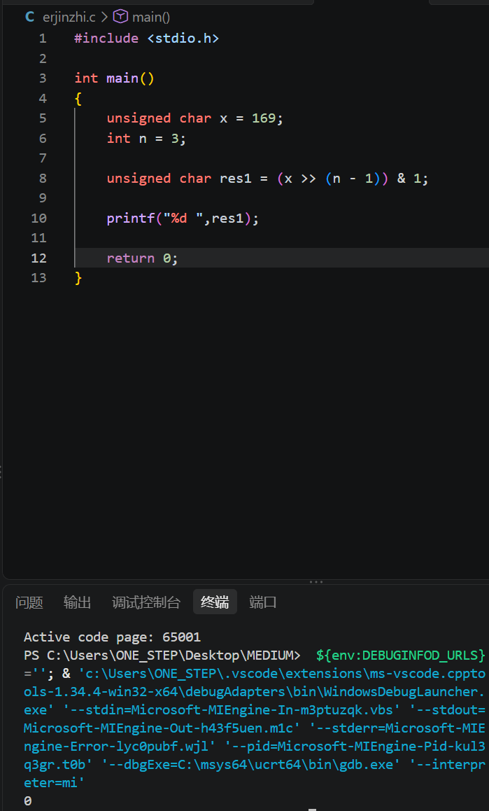
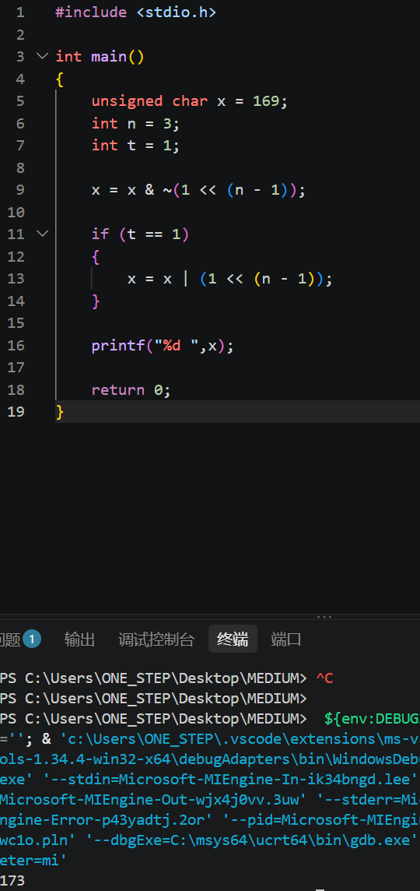
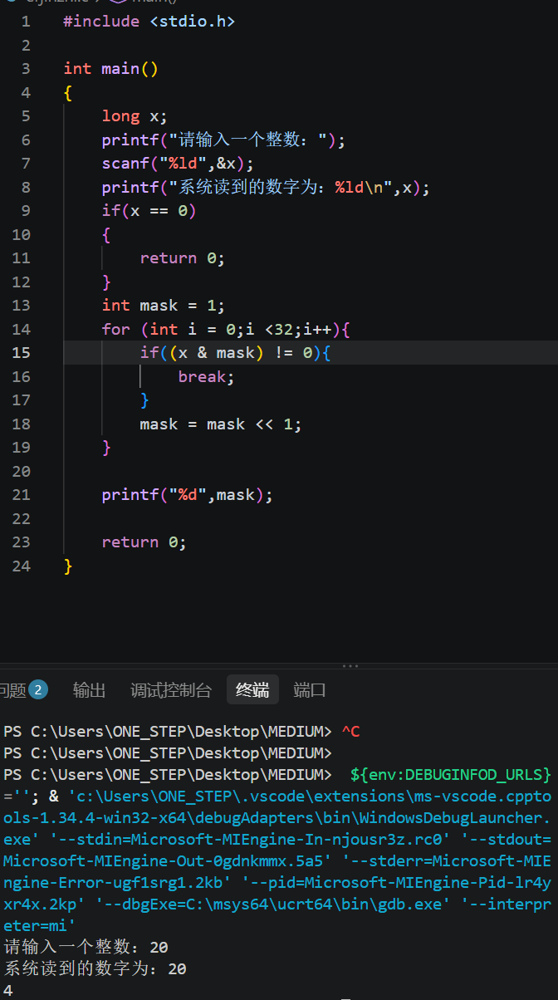
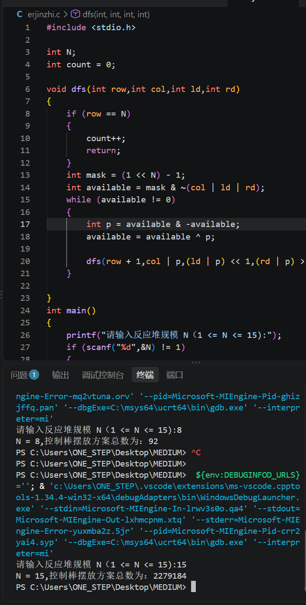
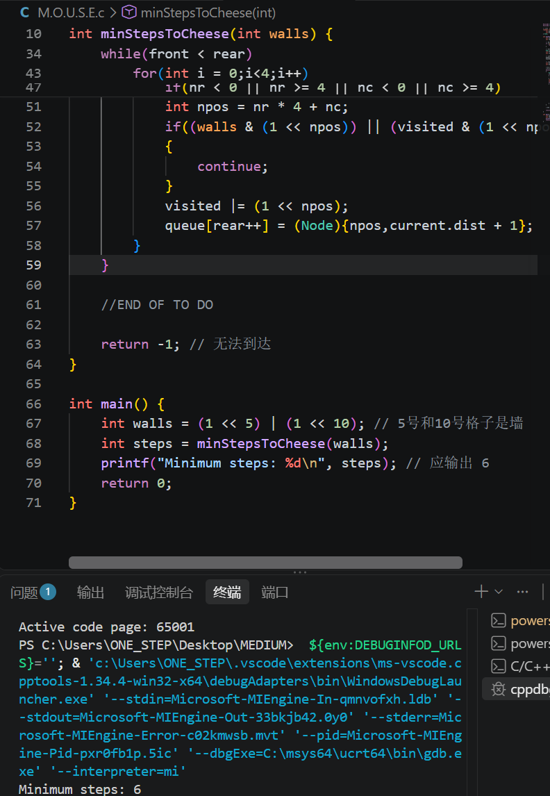

# 位级操作

## 模块一：启动引导区-语言的本源

### 任务 1

1.1 211的二进制为11001011  
2.1 10110110的十进制为364  
3.1 看十进制数个位数是奇数还是偶数，或者看二进制最后一个数字是1还是0  

## 模块二：能量阵列-逻辑门的重构

### 任务 2

1.1 res1 = 00001000,res2 = 00011101,res3 = 00010101,res4 = 00111100  
1.2 对应二进制位置进行比较，再根据运算符进行运算  
2.1 int main()  
{  
    unsigned char x = 169;  
    int n = 3;  

    unsigned char res1 = (x >> (n - 1)) & 1;  

    printf("%d ",res1);  

    return 0;  
}  
2.2   
3.1 int main()  
{  
    unsigned char x = 169;  
    int n = 3;  
    int t = 1;  

    x = x & ~(1 << (n - 1));   

    if (t == 1)  
    {  
        x = x | (1 << (n - 1));  
    }  

    printf("%d ",x);  

    return 0;  
}  
3.2   
4.1 int main()  
{  
    long x;  
    printf("请输入一个整数：");  
    scanf("%ld",&x);  
    printf("系统读到的数字为：%ld\n",x);  
    if(x == 0)  
    {  
        return 0;  
    }  
    int mask = 1;  
    for (int i = 0;i <32;i++){  
        if((x & mask) != 0){  
            break;  
        }  
        mask = mask << 1;  
    }  

    printf("%d",mask);  

    return 0;  
}  
4.2   
5.1

### 思考题

1.1 逻辑运算是对真和假的判断，一般只考虑最后一位的0或1；而位运算则是会对整个数字的每一个二进制进行比较。换句话说，逻辑运算的输出结果只会是真或假两个结果，位运算则会输出完整的运算结果。当操作数只有0和1时二者结果可以互相模拟。  
2.1 逻辑代数定律：交换律、结合律、分配律、幂等律、德摩根、零一律  
    掩码操作：特定位清0、特定位置1、特定位翻转、特定位提取  
    异或专属性质：自反性、可逆性、无临时变量交换  
    移位两条规律：左移乘2、右移除2  
    其他：整体独立性、优先级处于逻辑运算和算术运算之间  
3.1 因为算数运算中存在最前面的符号位表示该数的正负，如果右移过程符号位的数字变了会导致正负乃至数值发生巨大变化而导致程序出错，而逻辑运算则不存在正负区别只需要关注真或假，即1或。所以算数右移会有符号数并保留而逻辑右移没有符号数补0.  

## 模块三：通信模块-无碰撞协议

### 任务 3

1.1 int hasCommonChar(const char *s1, const char *s2) {  
    int mask1 = 0;  
    int mask2 = 0;  
    while (*s1 != '\0')  
    {  
        mask1 = mask1 | (1 << (*s1 - 'a'));  
        s1++;  
    }  
    while (*s2 != '\0')  
    {  
        mask2 = mask2 | (1 << (*s2 - 'a'));  
        s2++;  
    }  
    if ((mask1 & mask2) != 0)  
    {  
        return 1;  
    } else {  
        return 0;  
    }  
    return 0;  
}  

## 模块四：反应堆核心-绝对平衡的艺术

### 任务 4

1.1   
1.2 int N;  
int count = 0;  

void dfs(int row,int col,int ld,int rd)  
{  
    if (row == N)  
    {  
        count++;  
        return;  
    }  
    int mask = (1 << N) - 1;  
    int available = mask & ~(col | ld | rd);  
    while (available != 0)  
    {  
        int p = available & -available;  
        available = available ^ p;  

        dfs(row + 1,col | p,(ld | p) << 1,(rd | p) >> 1);  
    }  

}  
int main()  
{  
    printf("请输入反应堆规模 N（1 <= N <= 15):");  
    if (scanf("%d",&N) != 1)  
    {  
        printf("输入错误:请输入一个合法的整数！\n");  
        return 1;  
    }  
    if (N < 1 || N > 15)  
    {  
        printf("N 超出范围！\n");  
        return 1;  
    }  
    count = 0;  
    dfs(0,0,0,0);  
    printf("N = %d,控制棒摆放方案总数为：%d\n",N,count);  
    return 0;  
}  

## 模块五：管道穿梭-自动化寻路

### 任务 5

 while(front < rear)  
    {  
        Node current = queue [front++];  
        if (current.pos == target)  
        {  
            return current.dist;  
        }  
        int r = current.pos / 4;  
        int c = current.pos % 4;  
        for(int i = 0;i<4;i++)  
        {  
            int nr = r + dr[i];  
            int nc = c + dc[i];  
            if(nr < 0 || nr >= 4 || nc < 0 || nc >= 4)  
            {  
                continue;  
            }  
            int npos = nr * 4 + nc;  
            if((walls & (1 << npos)) || (visited & (1 << npos)))  
            {  
                continue;  
            }  
            visited |= (1 << npos);  
            queue[rear++] = (Node){npos,current.dist + 1};  
        }  
    }   
      